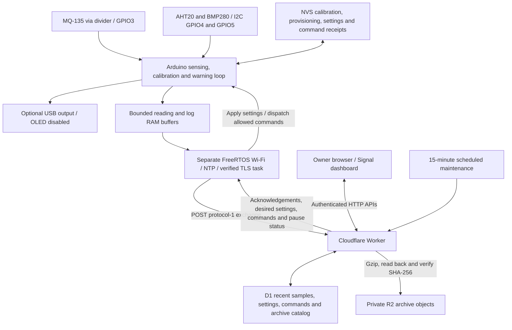

# Coop Monitor stack architecture

Source reviewed **5 November 2026 (Asia/Jakarta)** on branch `main`, HEAD `b4e5d30`, including uncommitted implementation changes. This describes implemented code/configuration. Deployment and physical observations retain their own dates in [verification](../VERIFICATION.md) and [deployment record](../cloud/coop-monitor-worker/DEPLOYMENT.md).

## End-to-end flow

The ESP initiates exchanges; the Worker does not open a connection to the device. Settings and commands wait for the next successful exchange. Local sensing/warnings continue during network failure or an upload pause, while unuploaded RAM records can be lost.

## Hardware and software

| Component | Setup / responsibility | Primary source |
|---|---|---|
| ESP32-C3 SuperMini | Single-core device running Arduino C++ and a separate FreeRTOS network task | [sketch](../firmware/coop_monitor/coop_monitor.ino), [runtime](../firmware/coop_monitor/dashboard_runtime.h) |
| MQ-135 | Relative gas response; 5 V heater/module, two 10 kOhm divider resistors, AO to GPIO3, DO unused | [wiring](../firmware/coop_monitor/WIRING.md) |
| AHT20/BMP280 | Temperature/humidity and temperature/pressure respectively; 3V3, shared I2C GPIO4 SDA/GPIO5 SCL | [sketch](../firmware/coop_monitor/coop_monitor.ino) |
| SSD1306 | 128x64 I2C OLED on the same bus; support retained but output disabled; intentionally disconnected in last recorded test | [sketch](../firmware/coop_monitor/coop_monitor.ino) |
| Firmware | `cloudflare-1.0.4`, protocol 1; Arduino ESP32 core 3.3.12 in the recorded build | [protocol types](../firmware/coop_monitor/dashboard_protocol.h), [build guide](../firmware/coop_monitor/README.md) |
| Firmware libraries | Local checked AHT20/BMP280 readers; Adafruit SSD1306, GFX and BusIO; core supplies Wire, Preferences, Wi-Fi, HTTP/TLS and cJSON | [firmware guide](../firmware/coop_monitor/README.md) |
| Worker | `src/index.ts` re-exports JavaScript `app.js`; routing, validation, auth, storage and archives | [entry](../cloud/coop-monitor-worker/src/index.ts), [routes](../cloud/coop-monitor-worker/src/app.js) |
| D1 / R2 | SQLite-based recent storage and private gzip object storage, through Worker bindings | [config](../cloud/coop-monitor-worker/wrangler.jsonc) |
| Frontend | Signal, vanilla HTML/CSS/JavaScript and Canvas trends; same-origin Worker assets | [HTML](../cloud/coop-monitor-worker/public/index.html), [app](../cloud/coop-monitor-worker/public/app.js), [trends](../cloud/coop-monitor-worker/public/trends.js) |
| Toolchain | Node v24.19.0 verified locally; `node:sqlite` tests; Wrangler pinned/locally checked at 4.148.0, pnpm lockfile | [package](../cloud/coop-monitor-worker/package.json), [wrapper](../cloud/coop-monitor-worker/cf.ps1) |

MicroSD, SHT31, Apps Script and QuickTest are historical workflows. The active build has no OTA, RTC module, battery monitor, fan/relay or buzzer output. The existing 4 MB partition layout retains one 2 MiB application slot and the old filesystem region; active Cloudflare firmware does not mount/format that legacy filesystem.

## Sensing and timing

The active bus runs at 100 kHz with OLED disabled. AHT20 reads wait for conversion, validate seven-byte CRC and retry a complete conversion within bounded limits. BMP280 validates identity, repeated factory trim and full transfers before compensation. Recovery counters distinguish retries from final failures. Replacement-module and closed-lid acquisition passed short tests on 4 November; original-module fault cause, accuracy and field endurance remain unproved.

MQ readings include raw ADC, divided-input millivolts, response/baseline ratio, active threshold and status. Environmental fields are `ahtTemperatureC`, `humidityPct`, `bmpTemperatureC` and `pressureHpa`. Missing values are null on the wire, not zero. **These measurements do not establish ammonia concentration or selectivity.**

Warnings require accepted calibration and valid conditions. Boot warm-up is ten minutes. Calibration stabilizes for ten minutes and collects for five, requiring at least 60 valid samples. The automatic threshold is `max(baseline * 1.15, baseline + 3 * SD)`. Manual range is 10–2399 mV at the divided ADC input; manual mode retains the warning guards. ADC at or above 2400 mV activates the high-input guard. Default confirmation is three consecutive samples; allowed range is 1–10.

| Activity | Source setting | Practical meaning |
|---|---|---|
| Normal sensing | Default 2 s, configurable 2–60 s | A cloud save must converge to the reported applied revision |
| Calibration sampling | 2 s | Temporarily overrides a slower monitoring interval |
| Device exchange | Normally about 2 s | Continues independently of slower sensing; failures back off with jitter |
| Paused exchange | Usually 60 s | Pending command receipts temporarily use 2 s; local sensing continues |
| Dashboard snapshots | 4 s while signed in | Reads stored backend state, not a synchronous sensor measurement |
| Overview trends | At most once/minute while visible | Full range initially; later two-minute overlap; manual refresh catches older late arrivals |
| Maintenance | `*/15 * * * *` UTC | Bounded archival/pruning/capacity checks, not immediate deletion at day 30 |

The last recorded device interval was five seconds, revision 4 (4 November); this is not today's readback. At two-second sampling the 64-reading RAM buffer represents roughly 128 seconds; at five seconds, roughly 320 seconds. Actual recovery depends on connectivity, exchange throughput and reboot/overflow.

## Persistence and data lifecycle

| Location | Contents | Survival / limits |
|---|---|---|
| RAM | 64 readings, 16 logs, in-flight exchange | Drop oldest on overflow; reboot/power loss discards pending data |
| NVS `coopcal` | Accepted calibration; replacement mq135-02 uses isolated mq02_* keys, old profile retained | Survives ordinary reboot/update; exported separately before authorized flashing |
| NVS `coopnet` / `coopcloud` | Wi-Fi / device ID, token and endpoint | Secrets; USB provisioning only; separate from owner key |
| NVS `coopcfg` / `coopcmd` | CRC-protected monitoring settings / 12-entry command receipt journal | Preserve for configuration and replay/recovery semantics |
| D1 | `devices`, `boot_sessions`, `reading_windows`, `device_logs`, `config_history`, `commands`, `archive_manifests`, `manual_archives`, `system_state`, `maintenance_leases` | Recent samples are minute-packed tuples, not averages; console logs target 24 h with pruning lag |
| Private R2 | Version-1 gzip JSON chunks and metadata | No configured automatic archive deletion; independent backups are still needed |

Schema is defined by [migrations 0001–0004](../cloud/coop-monitor-worker/migrations). Sample tuple order is authoritative in `SAMPLE_FIELDS` in [protocol.js](../cloud/coop-monitor-worker/src/protocol.js); archive documents carry `sampleFields` so readers can decode it explicitly.

Each boot has a random ID and 64-bit monotonic uptime. Original `sampledAt` stays null when unknown. D1 anchors a boot against server receipt time; History also returns `estimatedAt = anchorMs + uptimeMs`. Do not silently replace unknown original UTC with that estimate. Preserve device/boot/sequence identity, timestamps and payload on retries. Current duplicate checks operate within the immutable uptime-minute window; a changed-uptime retry is a known deferred integrity concern.

Automatic archival selects old device/hour chunks, gzip-compresses them, writes private R2 and reads back all bytes for SHA-256 verification. Manifest insertion and revision-guarded source deletion are transactional. Failures retain D1 source; concurrent changes can leave overlapping versions, so final analysis must check duplicates. Manual archival selects exact inclusive range tuples, records retry fingerprints and commits verified chunks with resumable job progress. Normal History/trends do not search R2.

## Protocol, authentication and commands

Configured exchange: `https://coop-monitor-worker.coop-monitor-worker.workers.dev/api/device/exchange`. Firmware exact-validates this endpoint, requires NTP before verified TLS and disables redirects. Maintain it during any domain migration.

Device bearer tokens are checked against D1 SHA-256 hashes. Owner APIs use a separate owner key or an eight-hour signed Secure/HttpOnly/SameSite=Strict cookie; cookie mutations require same origin. Static login assets and `/health` are public; health does not prove fresh telemetry. Login throttling is per isolate. There is no general-purpose remote shell.

The server accepts at most 30 readings/6 logs/5 command results in a 64 KiB request. Current firmware sends at most **12 readings/6 logs/5 results**, with bounded uptime-minute backlog. Only matching acknowledgements or permanent rejections retire records; paused uploads do not acknowledge unwritten readings. A 401 blocks uploads pending correction/reconnect; 400/409 requires diagnosis, not an assumption that retries fixed the contract.

Settings use a desired revision, atomic firmware validation/application and a separately reported applied revision/error. Calibration revision is a CRC32 profile fingerprint, not an increasing settings revision or security signature.

Allowed commands: `CAL_SHOW`, `CAL_EXPORT`, `CAL_START`, `CAL_CANCEL`, `NET_STATUS`, `NET_RECONNECT`, `CONFIG_SHOW`, `RESTART`, `HELP`, and from `cloudflare-1.2.0` the SD backup commands `SD_STATUS`, `SD_TAIL`, `SD_FLUSH`, `SD_EJECT`, `SD_MOUNT` (no arguments; older firmware skips unknown types and they expire). Acceptance is persisted and acknowledged before execution; running/terminal results retry. Interrupted execution can become `uncertain` without replay. `CAL_START` requires confirmed reference conditions. See the [device contract](../cloud/coop-monitor-worker/FIRMWARE_HANDOFF.md) for lifecycle/expiry details.

## Dashboard and operational limits

History supports 50/100/250/500/1000 entries, both orders and inclusive date ranges up to 31 days; default is 100 newest entries. Selection count is independent of loaded rows. Dates use DD/MM/YYYY and browser-local time. CSV export is paginated and formula-escaped; browser export follows cursor pages into numbered files of at most 50,000 readings each. Completed parts retain fallback download links and partial failures are reported; actual browser multi-download acceptance remains unverified. Preserve JSON/archive originals for exact text.

Trend ranges are 1h/6h/12h/24h; requests stop with an error above 120 pages/100,000 incoming readings. Display reduction preserves extrema; gaps/nulls/boots break lines. Cloud Console holds bounded events/results, not all USB output. Archives group manual IDs and automatic hours; all/selected ZIPs verify and preserve original gzip bytes in browser memory.

[Wrangler config](../cloud/coop-monitor-worker/wrangler.jsonc) sets application budgets of 500,000,000 D1 bytes, 10,000,000,000 archive bytes, 100,000 estimated daily writes/requests and a 21,600 request reserve. These are configured estimates, not freshly verified provider entitlements. Storage/write warnings begin near 80%; pauses near 95% also cover the request estimate. Missing or hour-old capacity checks pause uploads. A request-only pause may lack an earlier warning; paused/invalid traffic, actual owner traffic and R2 orphans are incompletely accounted for. See the [audit](BACKEND_AUDIT_2026-10-12.md) and [operations guide](../cloud/coop-monitor-worker/OPERATIONS.md) before capacity changes.

The [project handoff](PROJECT_HANDOFF.md) lists remaining implementation decisions and physical acceptance. Source correctness, local tests, deployment readback and field reliability are separate evidence layers.
