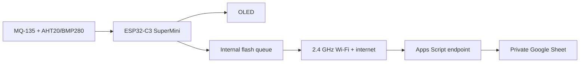

# Wi-Fi + Google Sheets coop monitor

`codex/wifi-cloud` replaces MicroSD logging in the integrated sketch with a
persistent LittleFS queue and authenticated HTTPS uploads. `main` remains the SD
version. The MQ-135 reading remains a relative gas response, not ammonia ppm.



## Wiring and power

Remove the MicroSD module. The sensor wiring is unchanged:

| Module pin | ESP32-C3 connection |
|---|---|
| MQ-135 VCC / GND | 5 V / VBUS and GND |
| MQ-135 AO | 10 kOhm to GPIO3; another 10 kOhm from GPIO3 to GND |
| MQ-135 DO | Unconnected |
| AHT20/BMP280 VCC / GND | 3V3 and GND |
| AHT20/BMP280 SDA / SCL | GPIO4 / GPIO5 |
| SSD1306 OLED VCC / GND | 3V3 and GND |
| SSD1306 OLED SDA / SCL | GPIO4 / GPIO5 |

```text
USB 5 V supply / power bank --> ESP32-C3 USB
5V / VBUS -------------------- MQ-135 VCC
3V3 -------------------------- AHT20/BMP280 VCC; OLED VCC
GND -------------------------- all module grounds
GPIO4 (SDA) ------------------ AHT20/BMP280 SDA; OLED SDA
GPIO5 (SCL) ------------------ AHT20/BMP280 SCL; OLED SCL

MQ-135 AO --- 10 kOhm ---+----- GPIO3
                         |
                       10 kOhm
                         |
                        GND
```

Use a stable USB supply suitable for the sensor heater, ESP32 Wi-Fi current
peaks, and display. A computer is needed for flashing/configuration; the monitor
then runs independently while powered and within Wi-Fi range. Internet and NTP
access are needed for certificate-validated uploads.

## Monitoring and queue

Sensors are sampled every two seconds. Calibration, warm-up, warning thresholds,
OLED readings, and readable Serial measurements are preserved. A separate
FreeRTOS task handles connection, clock synchronization, and HTTPS requests.
Gas/ADC warnings keep OLED priority; otherwise the bottom status line alternates
between sensor status and network state/pending count. Serial reports network
changes, failures, pending count, and cumulative discarded records.

The first reading is queued, followed by one every 30 seconds and whenever sensor
status changes. Network status changes alone do not create records. Each compact
record contains sensor data/status, sample number, boot ID, persistent sequence,
uptime, discarded count, and sampled UTC milliseconds when the clock is known.
Unsynchronized samples stay unknown even if uploaded later; Sheets independently
records receipt time. IDs include device MAC identity, random boot ID, and sequence.

The verified format is **128 bytes x 4,096 records = 524,288 bytes (512 KiB)**.
At the periodic rate this represents **34 hours 8 minutes**; status changes shorten
that duration. Filesystem metadata, retired portions of segments, and recovery
workspace use additional space in the 1,920 KiB LittleFS partition. This is a
verified logical capacity, not a physical flash endurance or power-cut result.
`QUEUE STATUS` reports actual mounted filesystem space on the device.

Overflow retires the oldest pending record and increments a persistent discarded
counter before retaining the new reading. This counts queue retirement; a lost
cloud acknowledgement can mean a retired record already exists in Sheets.
Batches contain up to 20 oldest records. Only matching acknowledged IDs advance
the queue; failed/lost acknowledgements retry with delays increasing from 5 seconds
to 5 minutes. Server deduplication makes retries safe.

CRC-protected records and two metadata checkpoints recover committed appends.
A short interrupted append is trimmed to the valid prefix. Corrupt complete
records, missing metadata for an existing log, or mount failures stop queue
storage and report an error. **No error automatically formats flash.** Live
monitoring continues, but readings cannot be retained while the queue is broken.

## Build and initial upload

Install Arduino ESP32 core and the Adafruit AHTX0, BMP280, SSD1306, GFX, BusIO,
and Unified Sensor libraries. The implementation was compiled with ESP32 core
3.3.11. Target `ESP32-C3 Super Mini`, USB CDC enabled, 4 MB flash, no OTA,
erase-all disabled. The supplied `partitions.csv` reserves a 2 MiB application
and keeps NVS at `0x9000` with size `0x5000`, as in the SD version.

```powershell
.\firmware\coop_monitor\build_wifi_cloud.ps1
.\firmware\coop_monitor\upload_wifi_cloud.ps1 -Port COM7
```

Replace `COM7` with the monitor's actual port. Close Serial Monitor first:
**only one process may own the COM port at a time**. The upload helper builds,
checks chip/flash using read-only `esptool flash-id`, requires a 4 MB ESP32-C3,
exports calibration to ignored `outputs/wifi-cloud/backups`, and uploads without
erasing NVS. It aborts if either hardware identification or calibration export
fails. Run `CAL SHOW` afterward and compare the backed-up values.

On a **known new/empty filesystem only**, explicitly send `QUEUE INIT EMPTY`
once to provision LittleFS. This command can erase an unmountable volume; do not
use it to repair a volume containing readings. A mounted volume is never erased
by this command. Preserve recoverable flash before investigating storage errors.

## Configure Wi-Fi and cloud

Create/deploy the endpoint using [Apps Script instructions](../../cloud/apps-script/README.md).
Use a regular 2.4 GHz network, not a captive portal. Open Serial Monitor at
115200 baud with a newline, then enter:

```text
WIFI SSID your-network-name
WIFI PASS your-network-password
CLOUD URL https://script.google.com/macros/s/DEPLOYMENT_ID/exec
CLOUD TOKEN your-64-character-hex-device-token
NET STATUS
QUEUE STATUS
```

SSID is at most 32 bytes; password is 8-63 bytes, or 64 hexadecimal characters.
`WIFI OPEN` explicitly selects an open network. Tokens are 64 hexadecimal
characters. Use the deployed `/exec` URL, not the editor URL or `/dev` URL.
`NET RECONNECT` forces connection retry. Secrets are masked in firmware output;
Serial input and terminal echo should not be captured in public logs.

Settings persist in Preferences namespace `coopnet`; calibration remains in
`coopcal`. Wi-Fi/cloud changes do not reset calibration. Local device settings
in `cloud.local.json` are excluded from Git. The manually launched helper below
prompts for the Wi-Fi password without echo and reads the endpoint/token from
that ignored file; it closes the port after configuring the device:

```powershell
.\firmware\coop_monitor\configure_network.ps1 -Port COM7
```

Google HTTPS certificates are validated against the included public Google PKI
roots. The first POST carries the token only to `script.google.com`. A Content
Service redirect is followed only to `script.googleusercontent.com` using GET
without replaying the token/body. The Sheet stays private; the public endpoint
rejects invalid device tokens and malformed records.

## Calibration and checks

Existing `CAL SHOW`, `CAL START`, `CAL CANCEL`, `CAL EXPORT`, `CAL IMPORT`,
and `HELP` remain available. See `HELP` for the import syntax and
existing calibration workflow. Calibration is still performed in clean air after
sensor warm-up, not by assigning a guessed ammonia concentration. Legacy SD
transfer commands/helpers apply only to `main`.

Condition a new MQ-135 for more than 48 hours initially. `CAL START` uses ten
minutes of stabilization followed by five minutes of collection with at least
60 valid samples. Failed/cancelled calibration preserves the previous result.
The warning threshold is the larger of baseline + 15% and baseline + 3 standard
deviations, and requires three consecutive qualifying samples. Boot warm-up,
active calibration, missing calibration and ADC-high states suppress gas warnings.

For restoration, replace the `@CAL,DATA,` prefix in a saved export line with
`CAL IMPORT,` and send the remaining fields unchanged. Do not import a backup
from a different MQ module, pin or voltage divider. `CAL SHOW`/`CAL EXPORT`
produce either the accepted data or `@CAL,MISSING,mq135-01`.

```powershell
.\firmware\coop_monitor\test_wifi_cloud.ps1
```

This runs queue fault injection, the existing reading formatter checks, and
Apps Script ingestion/deduplication tests. [Verification results](../../VERIFICATION.md)
distinguish these from live cloud and physical flash tests. Before unattended use,
verify actual sampling/warnings during wrong Wi-Fi credentials and internet
outages, duplicate/lost-ack retries, overflow, restart/power-cut recovery, and
calibration persistence. Switching back to `main` requires rebuilding/uploading
its SD firmware; a Git checkout alone does not change the device.
