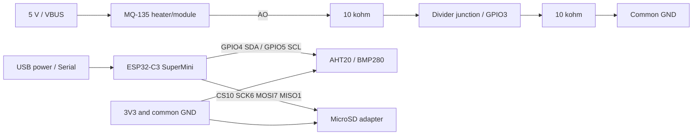

# Active Cloudflare monitor wiring

ESP32-C3 SuperMini, MQ-135, combined AHT20/BMP280 and a six-pin MicroSD adapter (firmware `cloudflare-1.1.0`, 15 November 2026). The OLED display is no longer part of the build. USB supplies power and local provisioning. Sensor wiring is unchanged, so MQ-135 readings keep the same ADC path as earlier runs. No GPIO is shared between parts. Diagram: [wiring_c3_proposal.html](../sd_backup_esp32_test/wiring_c3_proposal.html).

| Connection | ESP32-C3 / supply |
|---|---|
| MQ-135 VCC | 5 V / VBUS; heater needs its existing 5 V supply |
| MQ-135 GND | Common GND |
| MQ-135 AO | 10 kΩ → divider junction → GPIO3; junction → 10 kΩ → GND |
| MQ-135 DO | Unconnected |
| AHT20/BMP280 VCC | 3V3 |
| AHT20/BMP280 GND | Common GND |
| AHT20/BMP280 SDA | GPIO4 |
| AHT20/BMP280 SCL | GPIO5 |
| BOOT / GPIO9 | Normal bootloader use; no session stop action |
| SD CS / SCK / MOSI / MISO | GPIO10 / GPIO6 / GPIO7 / GPIO1 |
| SD 3V3 (adapter B: 3V3, CS, MOSI, CLK, MISO, GND) | 3V3 only, never 5 V; add 100 µF (10 µF minimum) across the adapter 3V3/GND |
| GPIO2, 8, 9, 20, 21 | Leave unused (boot strapping, LED/BOOT, UART) |

Never connect MQ AO directly to GPIO3. The dashboard's MQ mV threshold is the voltage at the divided ADC input; Serial also displays the estimated module output (`ADC voltage × 2`). Sensor results represent relative gas response, not validated ammonia ppm. This mapping is a source/documentation record, not a newly performed physical wiring test.
