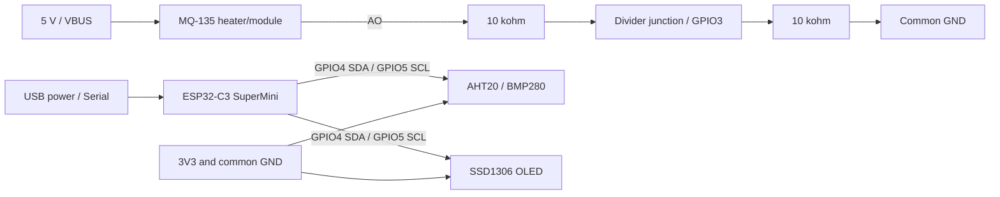

# Active Cloudflare monitor wiring

ESP32-C3 SuperMini, MQ-135, combined AHT20/BMP280 and SSD1306 OLED. USB supplies power and local provisioning. Sensor wiring is unchanged from the previous integrated monitor. The active firmware does not use MicroSD or the BOOT button for logging.

| Connection | ESP32-C3 / supply |
|---|---|
| MQ-135 VCC | 5 V / VBUS; heater needs its existing 5 V supply |
| MQ-135 GND | Common GND |
| MQ-135 AO | 10 kΩ → divider junction → GPIO3; junction → 10 kΩ → GND |
| MQ-135 DO | Unconnected |
| AHT20/BMP280 VCC, OLED VCC | 3V3 |
| AHT20/BMP280 GND, OLED GND | Common GND |
| Both I2C SDA | GPIO4 |
| Both I2C SCL | GPIO5 |
| BOOT / GPIO9 | Normal bootloader use; no session stop action |
| Previous SD GPIO10/6/7/1 | No active firmware use; remove SD-only wiring if present |

Never connect MQ AO directly to GPIO3. The dashboard's MQ mV threshold is the voltage at the divided ADC input; Serial also displays the estimated module output (`ADC voltage × 2`). Sensor results represent relative gas response, not validated ammonia ppm. This mapping is a source/documentation record, not a newly performed physical wiring test.
